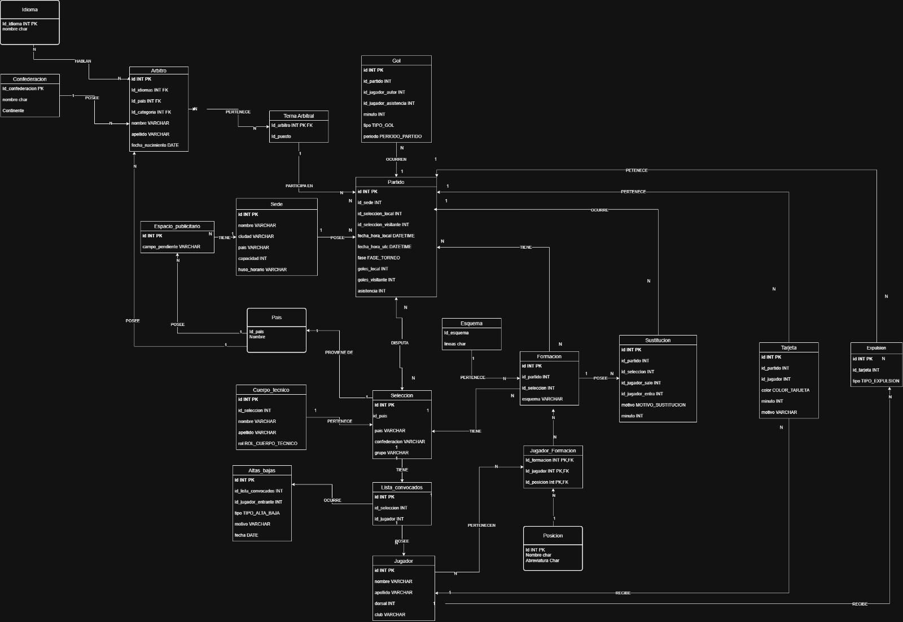

# TP Bases de Datos Aplicadas - Mundial de Fútbol ⚽

Repositorio de la entrega del **Grupo 8 (Comisión 2900)** para la materia **Bases de Datos Aplicadas (UNLaM)**.

El proyecto implementa el modelo completo de gestión para un Mundial de Fútbol en **MS SQL Server** bajo la base de datos `MundialDeFutbol`, separando las tablas en el esquema `Mundial` y los procedimientos almacenados en `MfSPabm`[cite: 1].

---

## 🗺️ Modelo de Datos (DER)

Diagrama Entidad-Relación implementado para el sistema:

---

## 📁 Cómo está organizado el repo

Para que sea fácil de seguir y corregir, numeramos todos los scripts del `01` al `52` según el orden exacto en el que se tienen que ejecutar[cite: 1]:

* **Raíz (`01` y `02`):** Creación de la base de datos, esquemas, tablas, claves e índices[cite: 1].
* **`ABMs/` (`03` al `23`):** Procedimientos almacenados de Alta, Baja y Modificación para todas las entidades del modelo (Selecciones, Jugadores, Partidos, Incidencias, Árbitros, Formaciones y Espacios Publicitarios)[cite: 1].
* **`SPs/` (`24` al `27`):** Reglas de negocio principales (designación arbitral sin conflicto de nacionalidad, carga de formaciones, acumulación de tarjetas amarillas y priorización de los 4 espacios publicitarios según rating/prime time)[cite: 1].
* **`seeds/` (`28` al `32`):** Juegos de datos iniciales para poblar las tablas y poder probar el sistema de punta a punta[cite: 1].
* **`test/` (`33` al `52`):** Scripts de prueba (relación 1:1 con cada ABM y SP) que verifican tanto los casos felices como las validaciones y errores esperados[cite: 1].

> **Nota sobre la codificación:** Todos los archivos `.sql` están guardados en **UTF-8 con BOM** para que SQL Server Management Studio (SSMS) lea bien las tildes y las `ñ` sin romper los caracteres[cite: 1].

---

## 🚀 Orden de ejecución en SSMS

Para levantar la base desde cero, abrí los archivos en **SQL Server Management Studio** y ejecutalos respetando esta secuencia[cite: 1]:

| Orden | Ubicación / Archivo | Descripción |
| :--- | :--- | :--- |
| **01** | `01_Bdd_Esquema.sql`[cite: 1] | Crea la BD `MundialDeFutbol` y los esquemas `Mundial` y `MfSPabm`[cite: 1]. |
| **02** | `02_tablas_creacion.sql`[cite: 1] | Crea todas las tablas, restricciones e índices *(es re-ejecutable)*[cite: 1]. |
| **03 - 07** | `ABMs/03_...` a `07_...`[cite: 1] | ABMs de País, Selección, Lista de Convocados, Jugador y Altas/Bajas[cite: 1]. |
| **08 - 12** | `ABMs/08_...` a `12_...`[cite: 1] | ABMs de Partido, Gol, Tarjeta, Expulsión y Sustitución[cite: 1]. |
| **13 - 14** | `ABMs/13_...` y `14_...`[cite: 1] | ABMs de Cuerpo Técnico y Posición[cite: 1]. |
| **15 - 19** | `ABMs/15_...` a `19_...`[cite: 1] | ABMs de Confederación, Sede, Árbitro, Idioma y Terna Arbitral[cite: 1]. |
| **20 - 23** | `ABMs/20_...` a `23_...`[cite: 1] | ABMs de Esquema, Formación, Jugador-Formación y Espacio Publicitario[cite: 1]. |
| **24** | `SPs/24_SP_Designacion_Arbitral.sql`[cite: 1] | Asigna ternas arbitrales validando que no haya conflicto de nacionalidad[cite: 1]. |
| **25** | `SPs/25_SP_Reglas_Negocio.sql`[cite: 1] | Carga de formación completa, cuerpo técnico en lote e historial de titularidad[cite: 1]. |
| **26** | `SPs/26_SP_Acumulacion_Tarjetas.sql`[cite: 1] | Registra amonestaciones/expulsiones y calcula suspensiones por acumulación[cite: 1]. |
| **27** | `SPs/27_SP_Priorizacion_Publicidad.sql`[cite: 1] | Simula franjas de *prime time* y asigna los 4 espacios publicitarios por prioridad[cite: 1]. |
| **28** | `seeds/28_seed_selecciones.sql`[cite: 1] | Carga inicial de países y selecciones[cite: 1]. |
| **29** | `seeds/29_seed_convocados_jugadores.sql`[cite: 1] | Carga inicial de listas de convocados y planteles[cite: 1]. |
| **30** | `seeds/30_seed_arbitros_infra.sql`[cite: 1] | Carga inicial de confederaciones, sedes, árbitros e idiomas[cite: 1]. |
| **31** | `seeds/31_seed_partidos.sql`[cite: 1] | Carga inicial de partidos de ejemplo[cite: 1]. |
| **30 *(bis)*** | `seeds/30_seed_arbitros_infra.sql`[cite: 1] | **Volver a correr** para generar las ternas arbitrales sobre los partidos recién cargados[cite: 1]. |
| **32** | `seeds/32_seed_posiciones_y_esquemas.sql`[cite: 1] | Carga inicial de posiciones y esquemas tácticos[cite: 1]. |
| **33 - 52** | `test/33_...` a `52_...`[cite: 1] | Batería de pruebas 1:1 para validar el funcionamiento de todos los SPs[cite: 1]. |
