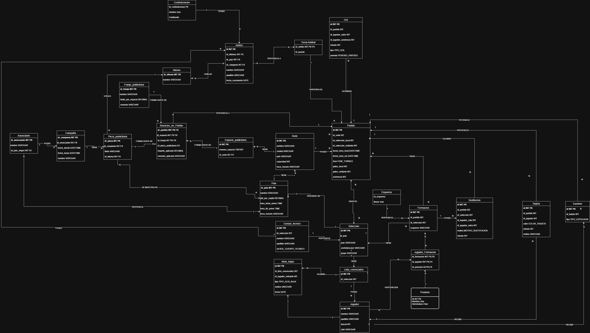

# TP Bases de Datos Aplicadas - Mundial de Fútbol 

Repositorio de la entrega del **Grupo 8 (Comisión 2900)** para la materia **Bases de Datos Aplicadas (UNLaM)**.

El proyecto implementa el modelo completo de gestión para un Mundial de Fútbol en **MS SQL Server** bajo la base de datos `MundialDeFutbol`, separando las tablas en el esquema `Mundial` y los procedimientos almacenados en `MfSPabm`.

---

## Modelo de Datos (DER)

Diagrama Entidad-Relación implementado para el sistema:


---

## Cómo está organizado el repo

Para que sea fácil de seguir y corregir, numeramos todos los scripts del `01` al `52` según el orden exacto en el que se tienen que ejecutar, aparte guardamos los archivos en UTF-8 con BOM para que no hayan errores al leer las tildes y las ñ:

* **Raíz (`01` y `02`):** Creación de la base de datos, esquemas, tablas, claves e índices.
* **`ABMs/` (`03` al `23`):** Procedimientos almacenados de Alta, Baja y Modificación para todas las entidades del modelo (Selecciones, Jugadores, Partidos, Incidencias, Árbitros, Formaciones y Espacios Publicitarios).
* **`SPs/` (`24` al `27`):** Reglas de negocio principales (designación arbitral sin conflicto de nacionalidad, carga de formaciones, acumulación de tarjetas amarillas y priorización de los 4 espacios publicitarios según rating/prime time).
* **`seeds/` (`28` al `32`):** Juegos de datos iniciales para poblar las tablas y poder probar el sistema de punta a punta.
* **`test/` (`33` al `52`):** Scripts de prueba (relación 1:1 con cada ABM y SP) que verifican tanto los casos felices como las validaciones y errores esperados.

---

## Orden de ejecución en SSMS

Para levantar la base desde cero, abrí los archivos en **SQL Server Management Studio** y ejecutalos respetando esta secuencia:

| Orden | Ubicación / Archivo | Descripción |
| :--- | :--- | :--- |
| **01** | `01_Bdd_Esquema.sql` | Crea la BD `MundialDeFutbol` y los esquemas `Mundial` y `MfSPabm`. |
| **02** | `02_tablas_creacion.sql` | Crea todas las tablas, restricciones e índices *(es re-ejecutable)*. |
| **03 - 07** | `ABMs/03_...` a `07_...` | ABMs de País, Selección, Lista de Convocados, Jugador y Altas/Bajas. |
| **08 - 12** | `ABMs/08_...` a `12_...` | ABMs de Partido, Gol, Tarjeta, Expulsión y Sustitución. |
| **13 - 14** | `ABMs/13_...` y `14_...` | ABMs de Cuerpo Técnico y Posición. |
| **15 - 19** | `ABMs/15_...` a `19_...` | ABMs de Confederación, Sede, Árbitro, Idioma y Terna Arbitral. |
| **20 - 23** | `ABMs/20_...` a `23_...` | ABMs de Esquema, Formación, Jugador-Formación y Espacio Publicitario. |
| **24** | `SPs/24_SP_Designacion_Arbitral.sql` | Asigna ternas arbitrales validando que no haya conflicto de nacionalidad. |
| **25** | `SPs/25_SP_Reglas_Negocio.sql` | Carga de formación completa, cuerpo técnico en lote e historial de titularidad. |
| **26** | `SPs/26_SP_Acumulacion_Tarjetas.sql` | Registra amonestaciones/expulsiones y calcula suspensiones por acumulación. |
| **27** | `SPs/27_SP_Priorizacion_Publicidad.sql` | Simula franjas de *prime time* y asigna los 4 espacios publicitarios por prioridad. |
| **28** | `seeds/28_seed_selecciones.sql` | Carga inicial de países y selecciones. |
| **29** | `seeds/29_seed_convocados_jugadores.sql` | Carga inicial de listas de convocados y planteles. |
| **30** | `seeds/30_seed_arbitros_infra.sql` | Carga inicial de confederaciones, sedes, árbitros e idiomas. |
| **31** | `seeds/31_seed_partidos.sql` | Carga inicial de partidos de ejemplo. |
| **30 *(bis)*** | `seeds/30_seed_arbitros_infra.sql` | **Volver a correr** para generar las ternas arbitrales sobre los partidos recién cargados. |
| **32** | `seeds/32_seed_posiciones_y_esquemas.sql` | Carga inicial de posiciones y esquemas tácticos. |
| **33 - 52** | `test/33_...` a `52_...` | Batería de pruebas 1:1 para validar el funcionamiento de todos los SPs. |

## Entrega 6 — Importación de sedes y partidos

Ejecutá `SPs/53_SP_Importacion_CSV_V2.sql` en SSMS para instalar los procedimientos de importación. Antes tienen que estar creadas las tablas, instalados los ABM de País (`03`), Partido (`08`) y Sede (`16`), y cargadas las selecciones del script `28`.

Para importar los datos, hay que ejecutar **primero sedes y después partidos**. Reemplazar `C:\TP\datasets\` por la ruta completa a la carpeta `datasets`. Esta ruta tiene que ser accesible desde SQL Server.

```sql
USE MundialDeFutbol;
GO

EXEC Mundial.sp_ImportarSedesCSV_V2
    @RutaArchivo = N'C:\TP\datasets\sedes_mundial_2026.csv';

EXEC Mundial.sp_ImportarPartidosCSV_V2
    @RutaArchivo = N'C:\TP\datasets\partidos_mundial_2026.csv';
```

Cada procedimiento muestra cuántos registros se insertaron, se actualizaron, quedaron sin cambios o se rechazaron. Los CSV de ejemplo incluyen **una fila inválida cada uno** para probar los rechazos. Volver a importar el mismo CSV no duplica los registros.

Para consultar los resultados y el historial de cambios:

```sql
SELECT *
FROM Mundial.ImportacionCSV_V2
ORDER BY id_log DESC;
```
